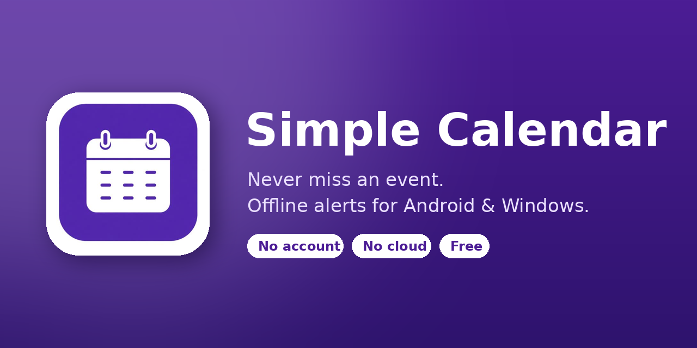

# 📅 Simple Calendar

A simple calendar that **never lets you miss an event**. Alarms ring on your phone or PC even when the app is closed, the screen is locked, or you're offline. There's no account and no cloud, and your events stay on your device.

**Latest version: v42**

## ⬇️ Download

> 🧹 **Updating?** First delete old Simple Calendar files from your **Downloads** folder (old `.apk`, `.part` and `.bat` files, including ones named like `(1)`), so you don't mix up versions.

### 📱 Android
**[⬇️ Tap to download the Android app (Simple-Calendar-v42.apk)](https://github.com/0MrCrazy0/calendar/raw/refs/heads/main/Simple-Calendar-Android-Installer/Simple-Calendar-v42.apk)**

[How to install on Android](https://github.com/0MrCrazy0/calendar/blob/main/Simple-Calendar-Android-Installer/README-Android.md)

### 💻 Windows
Download these 6 files into the same folder:

1. [⬇️ Part 1](https://github.com/0MrCrazy0/calendar/raw/refs/heads/main/Simple-Calendar-Windows-Installer/Simple-Calendar-Windows-Installer-v42.exe.00.part)
2. [⬇️ Part 2](https://github.com/0MrCrazy0/calendar/raw/refs/heads/main/Simple-Calendar-Windows-Installer/Simple-Calendar-Windows-Installer-v42.exe.01.part)
3. [⬇️ Part 3](https://github.com/0MrCrazy0/calendar/raw/refs/heads/main/Simple-Calendar-Windows-Installer/Simple-Calendar-Windows-Installer-v42.exe.02.part)
4. [⬇️ Part 4](https://github.com/0MrCrazy0/calendar/raw/refs/heads/main/Simple-Calendar-Windows-Installer/Simple-Calendar-Windows-Installer-v42.exe.03.part)
5. [⬇️ Part 5](https://github.com/0MrCrazy0/calendar/raw/refs/heads/main/Simple-Calendar-Windows-Installer/Simple-Calendar-Windows-Installer-v42.exe.04.part)
6. [⬇️ Install-Simple-Calendar-v42.bat](https://github.com/0MrCrazy0/calendar/raw/refs/heads/main/Simple-Calendar-Windows-Installer/Install-Simple-Calendar-v42.bat)

Then double-click **Install-Simple-Calendar-v42.bat**. It builds and opens the installer for you. Need help? See [How to install on Windows](https://github.com/0MrCrazy0/calendar/blob/main/Simple-Calendar-Windows-Installer/README-Windows.md). It takes about 2 minutes.

*iPhone isn't supported yet.*

## ✨ Features
- ⏰ Real alarms with 14 sounds (preview each one), snooze and volume control
- 🔁 Repeating events: daily, weekly, fortnightly, monthly, yearly
- 🌍 Works in any country and time zone. Alarms keep their local time when you travel or the clocks change for daylight saving.
- 🎨 Colour categories, themes and fonts
- 🔍 Search, marked days and a photo for each month
- 💾 Backup and restore, plus .ics export
- 🖥️ On a PC the calendar fills the whole window (maximise, or press F11 for full screen)
- 🌐 English, Norwegian and Tagalog
- 🔒 Private: no account, no cloud, works offline

## ⬆️ Updating
From v42, updating is one tap. When a new version is out, the app shows **Update available** with what's new. Tap **Download now**:
- **Android:** the app downloads the update, checks it, and opens Android's installer. Tap **Update**. The first time, Android asks you to allow Simple Calendar to install apps.
- **Windows:** the app downloads the update, checks it isn't damaged, and runs the installer. You also get a tray notification.

Your events and settings are kept. If you're on v41 or older, install v42 by hand once using the links above.

## ✅ To never miss an alarm
- **Android:** allow notifications and alarms, and set Battery to **Unrestricted**. Open the app at least once a month.
- **Windows:** keep the app running in the tray (it starts with Windows).
