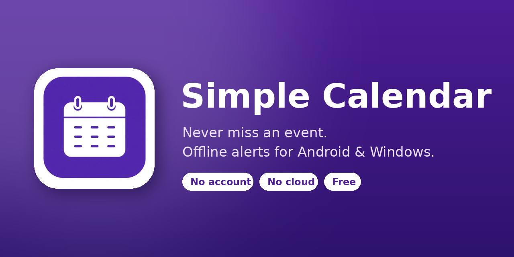

# 📅 Simple Calendar

A simple calendar that **never lets you miss an event**. Alarms ring on your phone or PC even when the app is closed, the screen is locked, or you're offline. There's no account and no cloud, and your events stay on your device.

## ⬇️ Download

### 📱 Android
**[⬇️ Tap to download the Android app (.apk)](https://github.com/0MrCrazy0/calendar/raw/refs/heads/main/Simple-Calendar-Android-Installer/Simple-Calendar-Android-Installer.apk)**

[How to install on Android](https://github.com/0MrCrazy0/calendar/blob/main/Simple-Calendar-Android-Installer/README-Android.md)

### 💻 Windows
Download these 6 files into the same folder:

1. [⬇️ Part 1](https://github.com/0MrCrazy0/calendar/raw/refs/heads/main/Simple-Calendar-Windows-Installer/Simple-Calendar-Windows-Installer.exe.00.part)
2. [⬇️ Part 2](https://github.com/0MrCrazy0/calendar/raw/refs/heads/main/Simple-Calendar-Windows-Installer/Simple-Calendar-Windows-Installer.exe.01.part)
3. [⬇️ Part 3](https://github.com/0MrCrazy0/calendar/raw/refs/heads/main/Simple-Calendar-Windows-Installer/Simple-Calendar-Windows-Installer.exe.02.part)
4. [⬇️ Part 4](https://github.com/0MrCrazy0/calendar/raw/refs/heads/main/Simple-Calendar-Windows-Installer/Simple-Calendar-Windows-Installer.exe.03.part)
5. [⬇️ Part 5](https://github.com/0MrCrazy0/calendar/raw/refs/heads/main/Simple-Calendar-Windows-Installer/Simple-Calendar-Windows-Installer.exe.04.part)
6. [⬇️ Install-Simple-Calendar.bat](https://github.com/0MrCrazy0/calendar/raw/refs/heads/main/Simple-Calendar-Windows-Installer/Install-Simple-Calendar.bat)

Then double-click **Install-Simple-Calendar.bat**. It builds and opens the installer for you. Need help? See [How to install on Windows](https://github.com/0MrCrazy0/calendar/blob/main/Simple-Calendar-Windows-Installer/README-Windows.md). It takes about 2 minutes.

*iPhone isn't supported yet.*

## ✨ Features
- ⏰ Real alarms with 5 sounds, snooze and volume control
- 🔁 Repeating events: daily, weekly, fortnightly, monthly, yearly
- 🎨 Colour categories, themes and fonts
- 🔍 Search, marked days and a photo for each month
- 💾 Backup and restore, plus .ics export
- 🌐 English, Norwegian and Tagalog
- 🔒 Private: no account, no cloud, works offline

## ✅ To never miss an alarm
- **Android:** allow notifications and alarms, and set Battery to **Unrestricted**. Open the app at least once a month.
- **Windows:** keep the app running in the tray (it starts with Windows).
